# Azure - Uppgift 8 (V41) Examination
**Nordvik Fastigheter AB: hyresgästportal med felanmälan**

**Namn:** Simon Fatty

**Repo:** https://github.com/02simfat/azure-MOV25 (koden ligger i mappen `V41`)

**Datum:** 2026-10-11

---

## Innehåll

- [Översikt](#översikt)
- [Arkitektur](#arkitektur)
- [Nordviks behov och mina designbeslut](#nordviks-behov-och-mina-designbeslut)
- [För G](#för-g)
- [Del A: Azure-tjänster och val av nivå](#del-a-azure-tjänster-och-val-av-nivå)
- [Del B: Lösningen](#del-b-lösningen)
  - [1. Compute](#1-compute)
  - [2. IAM](#2-iam)
  - [3. Nätverk och säkerhet (defense in depth)](#3-nätverk-och-säkerhet-defense-in-depth)
  - [4. Storage](#4-storage)
  - [5. IaC med ARM](#5-iac-med-arm)
  - [6. Automation och integration med Microsoft 365](#6-automation-och-integration-med-microsoft-365)
  - [7. Dokumentation och återskapning](#7-dokumentation-och-återskapning)
- [Kostnad](#kostnad)
- [Avgränsningar](#avgränsningar)
- [Problem och felsökning](#problem-och-felsökning)
- [Nästa steg (förbättringar)](#nästa-steg-förbättringar)
- [Filer](#filer)

---

## Översikt

Nordvik Fastigheter AB vill att hyresgäster ska kunna göra en **felanmälan** på webben. En felanmälan har rubrik, beskrivning och en bild.

Det här händer när en hyresgäst skickar in en felanmälan:

1. Formuläret skickas till portalen. Portalen körs på ett **scale set** med två servrar bakom en **lastbalanserare**.
2. Portalen sparar felanmälan som JSON, och bilden, i **Blob Storage**. Den loggar in med en **hanterad identitet**. Det finns ingen nyckel i koden.
3. Portalen skickar felanmälan vidare till ett flöde i **Power Automate**.
4. Flödet slår upp **rätt förvaltare** för fastigheten och skapar en rad i SharePoint-listan **Felanmälningar**.
5. Förvaltaren får en **notis i Teams**. Är felet **akut** (värme, vatten eller lås) får förvaltaren också ett **mejl direkt** med hög prioritet.

Allt i Azure byggs med kod: en **ARM-template** och skriptet `build.sh`. Hela miljön kan rivas med `destroy.sh` och byggas upp igen från repot.

---

## Arkitektur

**Bild 0.** Arkitekturskiss.

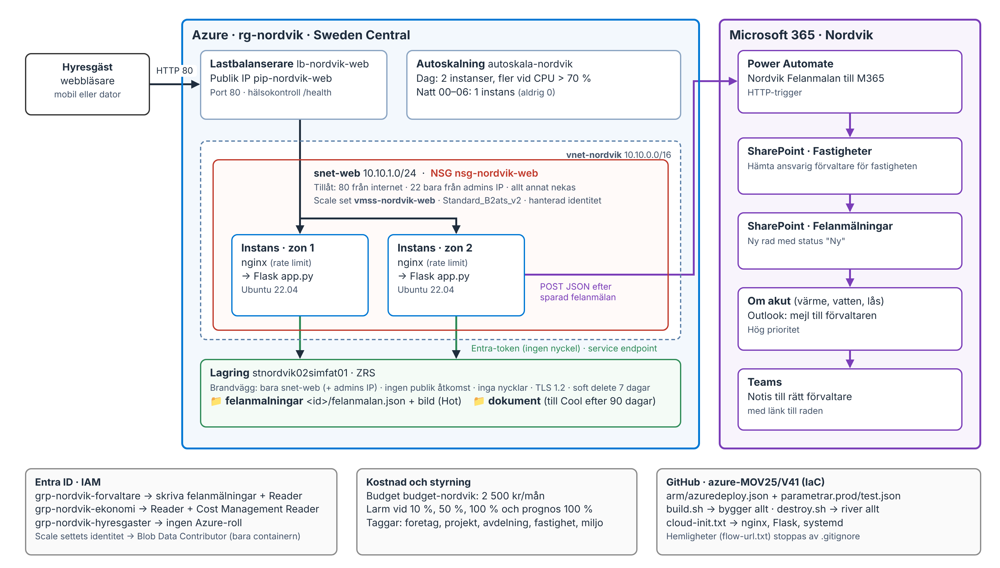

Samma sak som text:

```text
Hyresgäst (webbläsare)
   │  HTTP port 80
   ▼
Lastbalanserare lb-nordvik-web (publik IP)      ← enda vägen in från internet
   │  hälsokontroll /health
   ▼  snet-web 10.10.1.0/24  (NSG: bara 80 in, SSH bara från min IP)
Scale set vmss-nordvik-web                       ← 2 instanser i zon 1 och 2
   │  nginx → Flask (app.py), hanterad identitet
   │  Entra-token, ingen nyckel
   ▼  service endpoint
Lagring stnordvik02simfat01 (ZRS)                ← ingen publik åtkomst, brandvägg: bara snet-web
   ├── felanmalningar   <id>/felanmalan.json + <id>/bild.jpg   (Hot)
   └── dokument         kontrakt och protokoll                   (till Cool efter 90 dagar)

app.py (efter sparad felanmälan) ── POST JSON ──► Power Automate
                                                  ├── SharePoint: hämta förvaltare i listan Fastigheter
                                                  ├── SharePoint: ny rad i listan Felanmälningar
                                                  ├── Om akut: Outlook-mejl till förvaltaren (hög prioritet)
                                                  └── Teams: notis till förvaltaren
```

Varför den här ordningen? Felanmälan sparas **först** i Azure. Sedan anropas flödet. Om flödet är nere finns felanmälan ändå kvar i lagringen. Ingen anmälan försvinner.

---

## Nordviks behov och mina designbeslut

Det här är kärnan i designen. Varje beslut kommer från ett behov i uppgiften.

| Nordviks behov | Vad det betyder | Mitt designbeslut | Delmoment |
| :--- | :--- | :--- | :--- |
| Hyresgäster, ca 40 förvaltare och 6 på ekonomi | Tre roller med olika behov | En Entra-grupp per roll. Minsta möjliga behörighet per grupp. | 2 |
| Topp 07–09 och 17–20. Nästan ingen trafik 00–06. | Lasten är ojämn | Autoskalning: CPU-regel och en nattprofil | 1 |
| 5–10 samtidiga, upp mot 120 vid månadsskifte | Toppar | Scale set som kan skala ut | 1 |
| 70 anmälningar per dygn, 300 på en timme vid en vattenläcka | Skurar av händelser | Spara i Blob först, anropa flödet sedan. Flödet får aldrig stoppa sparandet. | 4, 6 |
| Varje anmälan ska bli en post i en lista och en notis till **ansvarig** förvaltare | M365-integration med uppslag | Flöde: HTTP-trigger → slå upp förvaltare i listan Fastigheter → ny rad i Felanmälningar → notis | 6 |
| Värme, vatten och lås är akuta och ska ge mejl direkt | Formuläret behöver fältet **kategori** | Appen sätter `akut = true` för de tre. Flödet skickar mejl med hög prioritet. | 1, 6 |
| Bilder på 2–5 MB, 5–10 GB nya bilder per år | Lagringen växer lugnt | Blob Storage, nivå Hot. Max 10 MB per bild i nginx och appen. | 4 |
| Kontrakt och protokoll 40 GB, läses sällan efter 3 månader | Dyrt att ha allt i Hot | Egen container `dokument` och en livscykelregel: till Cool efter 90 dagar | 4 |
| 99,5 % på kontorstid. Ska tåla att en instans faller bort. | En server räcker inte | Minst 2 instanser i två zoner, bakom en lastbalanserare med hälsokontroll | 1, 3 |
| Ungefär 2 500 kr per månad. Vill inte betala för natten. | Kostnadstak | Liten B-storlek. Skala ner på natten, men **inte till 0**: en vattenläcka kl. 03 måste gå att anmäla. Budgetlarm på 2 500 kr. | 1, 5 |
| Växer med 5–8 fastigheter per år. Vill snabbt kunna resa en test- eller demomiljö. | Måste gå att återskapa | ARM-template med en parameterfil per miljö (prod och test). En ny fastighet är en ny rad i listan Fastigheter. Ingen kod ändras. | 5, 6 |
| Personuppgifter. Lagringen får inte vara publik. Åtkomst per roll. | Säkerhet | Ingen publik blob-åtkomst, inga nycklar, lagringen nås bara från webbsubnätet | 3, 4 |
| Ekonomi följer kostnad per fastighet och avdelning | Taggar på allt | Taggarna `foretag`, `projekt`, `avdelning`, `fastighet`, `miljo`. Delade resurser har `fastighet=Gemensam`. | 5 |

---

## För G

| Krav | Vad jag gjorde | Visas i |
| :--- | :--- | :--- |
| Del A: förklara Compute, nätverk och storage | Tjänsterna förklarade, och vad Nordvik använder | Del A |
| Del A: VM, container och serverless, med ett val för Nordvik | Jämförelse och motiverat val: VM-nivå med scale set | Del A |
| 1. Compute: värdmiljö och formulär (rubrik, beskrivning, bild) | Scale set med 2 instanser, lastbalanserare, formulär med kategori och bild | Avsnitt 1, bild 8–10 och 12 |
| 2. IAM: least privilege och hanterad identitet | Entra-grupper med RBAC, identitet med rätt bara på containern | Avsnitt 2, bild 13–14 |
| 3. Nätverk och säkerhet: defense in depth | NSG, lagringsbrandvägg, service endpoint, rate limit, validering | Avsnitt 3, test 2–5 |
| 4. Storage: felanmälan med bild sparas säkert | JSON och bild per felanmälan, ingen publik åtkomst | Avsnitt 4, bild 13–14 |
| 5. IaC: ARM i GitHub, kan återskapas | `arm/azuredeploy.json`, parameterfiler, `build.sh`, `destroy.sh` | Avsnitt 5, bild 8 och 11 |
| 6. Automation: post i lista och notis till rätt förvaltare | Power Automate med SharePoint, Teams och Outlook | Avsnitt 6, bild 1–7 och 15–16 |
| 7. Dokumentation | Den här README:n, steg för att återskapa, felsökning | Avsnitt 7 |

---

# Del A: Azure-tjänster och val av nivå

## A1. Compute: där koden körs

Compute är tjänsterna som **kör** kod. De skiljer sig i hur mycket jag sköter själv.

| Tjänst | Vad det är | Passar för |
| :--- | :--- | :--- |
| **Virtuell maskin (VM)** | En hel server med eget operativsystem | Full kontroll, egen programvara |
| **VM Scale Set** | En grupp likadana VM:ar. Kan skala ut och in automatiskt. Används med en lastbalanserare. | Webb som ska tåla att en server faller bort |
| **App Service** | Plattform för webbappar. Azure sköter operativsystemet. | Vanliga webbappar utan egen serverdrift |
| **Container Instances (ACI)** | Kör en container snabbt, betala per sekund | Test och korta jobb (som i V40) |
| **Container Apps** | Kör containrar i drift. Skalar automatiskt, även till 0. | Webb och API:er som containrar |
| **AKS (Kubernetes)** | Kluster för många containrar | Stora system med många tjänster |
| **Azure Functions** | Serverless: bara kod som körs vid en trigger | Korta jobb som körs ojämnt |

**Nordvik använder:** ett **VM Scale Set** (`vmss-nordvik-web`) med Ubuntu 22.04. Power Automate körs i Microsoft 365 och är också "compute", men där sköter Microsoft allt.

## A2. Nätverk: hur trafiken går

| Tjänst | Vad det är | Nordvik |
| :--- | :--- | :--- |
| **Virtuellt nätverk (VNet)** | Ett privat nätverk i Azure | `vnet-nordvik` 10.10.0.0/16 |
| **Subnät** | En del av VNet. Delar upp resurser. | `snet-web` 10.10.1.0/24 för webbservrarna |
| **NSG (Network Security Group)** | Brandväggsregler: vilken trafik får komma in och ut | `nsg-nordvik-web`: bara port 80 från internet, SSH bara från min IP |
| **Publik IP** | En adress som nås från internet | `pip-nordvik-web`, sitter på lastbalanseraren |
| **Load Balancer** | Fördelar trafik på lager 4 (TCP). Hälsokontroll tar bort trasiga servrar. | `lb-nordvik-web` med hälsokontroll `/health` |
| **Application Gateway** | Lastbalanserare på lager 7 (HTTP). Kan ha TLS och WAF. | Används inte. Nästa steg för HTTPS (se Avgränsningar). |
| **Service endpoint** | Subnätet når en Azure-tjänst via Microsofts nät. Tjänsten kan låsas till subnätet. | `Microsoft.Storage` på `snet-web` |
| **Private endpoint** | Tjänsten får en privat IP inne i VNet | Starkare än service endpoint, men kostar mer. Nästa steg. |
| **VPN Gateway / ExpressRoute** | Koppla kontoret till Azure | Behövs inte. Portalen är publik. |

## A3. Storage: var data sparas

Ett **lagringskonto** innehåller fyra typer av lagring:

| Typ | Vad | Nordvik |
| :--- | :--- | :--- |
| **Blob** | Filer och ostrukturerad data: bilder, JSON, PDF | Felanmälningar, bilder och dokument |
| **Files** | Fildelning (SMB), som en nätverksdisk | Används inte |
| **Queue** | Meddelandekö mellan delar av ett system | Nästa steg vid stora skurar (se Nästa steg) |
| **Table** | Enkel NoSQL-tabell | Används inte |

Utöver det finns **managed disks**: diskarna till VM:arna. Varje instans i scale settet har en OS-disk.

**Redundans** (hur många kopior och var):

| Nivå | Kopior | Nordvik |
| :--- | :--- | :--- |
| **LRS** | 3 kopior i ett datacenter | Testmiljön (billigast) |
| **ZRS** | 3 kopior i tre zoner | **Drift**. Tål att ett datacenter går ner. |
| **GRS / GZRS** | Kopior även i en annan region | Behövs inte för Nordvik nu |

**Åtkomstnivåer** (pris för lagring mot pris för läsning):

| Nivå | Passar | Nordvik |
| :--- | :--- | :--- |
| **Hot** | Data som läses ofta | Nya felanmälningar och bilder |
| **Cool** | Läses sällan, sparas minst 30 dagar | Kontrakt och protokoll efter 90 dagar |
| **Cold / Archive** | Läses nästan aldrig | Gamla protokoll i framtiden |

## A4. VM, container eller serverless?

| Nivå | Jag sköter | Kostnad | Skalning | Start |
| :--- | :--- | :--- | :--- | :--- |
| **VM / scale set** | Mest: OS, paket, säkerhet | Per timme, så länge den kör | Scale set skalar på regler. Nya instanser tar några minuter. | Minuter |
| **Container** (Container Apps) | Mindre: bara imagen och appen | Per körande instans | Snabb, kan gå till 0 | Sekunder |
| **Serverless** (Functions) | Minst: bara koden | Per körning | Automatisk | Direkt (utom cold start) |

Mönstret: **ju högre nivå, desto mindre drift, men desto mindre kontroll.**

## A5. Mitt val för Nordvik: VM-nivå med scale set

Jag valde **ett VM Scale Set bakom en lastbalanserare**.

**Varför:**

- **Tillgänglighet.** Nordvik kräver 99,5 % och att en instans får falla bort. Två instanser i **två zoner** bakom en lastbalanserare med hälsokontroll klarar det.
- **Ojämn last.** Autoskalning skalar ut vid hög CPU och ner till 1 instans på natten.
- **Aldrig 0.** En vattenläcka kl. 03 måste gå att anmäla. Därför passar det inte att skala till 0, som serverless och Container Apps gör.
- **Säkerhet utan nycklar.** Scale settet får en hanterad identitet som bara får skriva i en container.
- **Kontroll.** Jag styr nginx själv: rate limit, säkerhetsrubriker och maxstorlek på bilder.
- **Beprövat.** Samma kedja (cloud-init → nginx → Flask → Blob) har jag byggt och testat i V37–V39. Det minskar risken.
- **Kostnad.** En liten B-storlek håller sig långt under 2 500 kr (se Kostnad).

**Nackdelar som jag accepterar:**

- Jag måste sköta operativsystemet (uppdateringar).
- En ny instans tar några minuter att starta. Därför börjar dagen med 2 instanser, inte 1.
- Jag betalar för minst 1 instans även på natten.

**Varför inte de andra?**

- **Container (Container Apps):** bra för webbsidan och mindre drift. Men jag hade behövt bygga om appen till en image och lösa identitet och nätverk på nytt. I V40 testade jag bara en container utan formulär. Det var för stor risk med den tid jag hade. Det är ett bra **nästa steg**.
- **Serverless (Functions):** passar **mottagningen** av felanmälan bäst: korta jobb, skurar på 300 per timme, betala per körning. Men webbsidan ska alltid svara, och en Function behöver mer nytt (Graph, app-registrering). Jag ser det som nästa steg: webbsidan kvar, mottagningen som Function.

En lösning får blanda nivåer. För Nordvik idag ger scale set bäst balans mellan **tillgänglighet, kontroll och risk**.

---

# Del B: Lösningen

## 1. Compute

**Vad:** ett scale set `vmss-nordvik-web` med 2 instanser av `Standard_B2ats_v2` (2 vCPU, 1 GB) i zon 1 och zon 2. Ubuntu 22.04. Lastbalanseraren `lb-nordvik-web` fördelar trafiken.

**Hur appen kommer upp:** `cloud-init.txt` körs när en instans startar. Den installerar nginx och Python, skriver `index.html`, `app.py`, nginx-konfigen och en systemd-tjänst. Varje ny instans blir därför likadan, även när autoskalningen lägger till en.

Scale settet skapas så här i `build.sh`:

```bash
az vmss create -g "$RG" -n "$VMSS" \
  --orchestration-mode Uniform \
  --image Ubuntu2204 --vm-sku "$storlek" --instance-count "$INSTANSER" "$@" \
  --subnet "$SUBNET_ID" --nsg "$NSG" \
  --lb "$LB" --lb-sku Standard --backend-pool-name "$BEPOOL" --public-ip-address "$PIP" \
  --upgrade-policy-mode Manual \
  --admin-username azureuser --generate-ssh-keys \
  --assign-identity \
  --custom-data cloud-init.generated.txt \
  --tags $TAGGAR -o none
```

| Rad | Varför |
| :--- | :--- |
| `--instance-count 2` | Portalen ska tåla att en instans faller bort |
| `--zones 1 2` (i `$@`) | Instanserna hamnar i olika datahallar |
| `--nsg "$NSG"` | Nätverkskorten får **samma** NSG som subnätet (se Problem 2) |
| `--lb ... --lb-sku Standard` | En lastbalanserare framför instanserna |
| `--assign-identity` | Hanterad identitet. Ingen nyckel behövs till lagringen. |
| `--custom-data` | cloud-init installerar appen |

Skriptet provar flera små storlekar i tur och ordning, eftersom Azure ibland saknar kapacitet (se Problem 1).

**Hälsokontroll:** lastbalanseraren frågar `/health` på varje instans. Svarar den inte tas den ur drift.

```bash
az network lb probe create -g "$RG" --lb-name "$LB" -n probe-health \
  --protocol Http --port 80 --path /health -o none
```

**Autoskalning** (Nordviks toppar och tomma nätter):

```bash
az monitor autoscale create -g "$RG" --resource "$VMSS" \
  --resource-type Microsoft.Compute/virtualMachineScaleSets \
  --name autoskala-nordvik --min-count "$INSTANSER" --max-count "$MAX" --count "$INSTANSER"
az monitor autoscale rule create -g "$RG" --autoscale-name autoskala-nordvik \
  --condition "Percentage CPU > 70 avg 5m" --scale out 1
az monitor autoscale rule create -g "$RG" --autoscale-name autoskala-nordvik \
  --condition "Percentage CPU < 30 avg 5m" --scale in 1
az monitor autoscale profile create -g "$RG" --autoscale-name autoskala-nordvik \
  --name natt --min-count 1 --count 1 --max-count 2 \
  --timezone "W. Europe Standard Time" --start 00:00 --end 06:00 \
  --recurrence week mon tue wed thu fri sat sun
```

- Dagtid: minst 2 instanser. Över 70 % CPU i 5 minuter: en till. Under 30 %: en färre.
- Natt 00–06: 1 instans. Inte 0, så att akuta fel alltid kan anmälas.
- `MAX` räknas ut från prenumerationens vCPU-kvot (se Avgränsningar).

**Formuläret** har fälten rubrik, fastighet, lägenhet, kategori, beskrivning, e-post och bild. Kategori och fastighet är rullistor. Då stämmer värdena alltid med SharePoint-listorna.

### Verifiering

**Bild 8.** `bash build.sh` gick hela vägen till KLART.

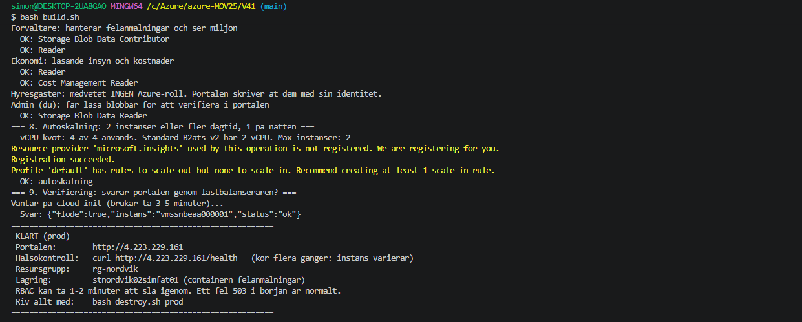

**Bild 9.** `/health` svarar genom lastbalanseraren. `instans` visar vilken server som svarade.

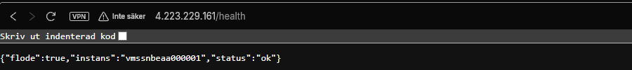

**Bild 10.** Formuläret på lastbalanserarens publika IP.

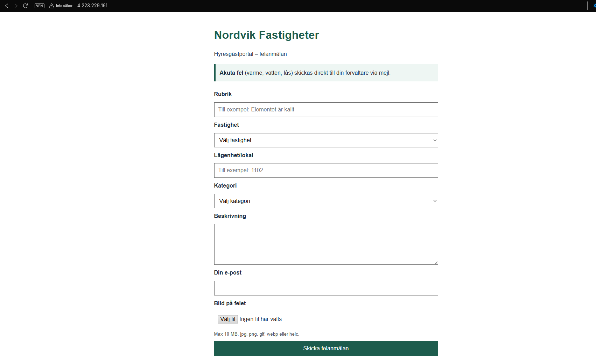

**Bild 12.** Tack-sidan efter en felanmälan med bild. Ärende-ID `20261011T101015Z-f30dfc2a`. Kategorin Vatten är akut, så sidan visar en röd ruta.

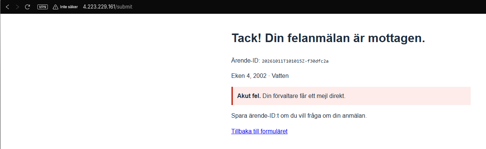

**Test 2: lastbalanseraren fördelar trafiken.** Jag frågar `/health` flera gånger. `instans` ska växla mellan de två servrarna.

```bash
for i in 1 2 3 4 5 6; do curl -s http://4.223.229.161/health; echo; done
```

Resultat: svaren växlar mellan `vmssnbeaa000000` (zon 1) och `vmssnbeaa000001` (zon 2). Lastbalanseraren skickar trafiken till båda servrarna.

**Bild 17.** Svaren kommer från båda instanserna.

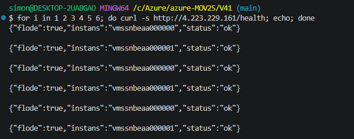

**Test 3: portalen tål att en instans faller bort.** Jag stänger av en instans och laddar sidan igen.

```bash
az vmss list-instances -g rg-nordvik -n vmss-nordvik-web --query "[].{nr:instanceId, namn:osProfile.computerName, zon:zones[0]}" -o table
az vmss stop -g rg-nordvik -n vmss-nordvik-web --instance-ids 0
for i in 1 2 3 4 5 6; do curl -s http://4.223.229.161/health; echo; done
az vmss start -g rg-nordvik -n vmss-nordvik-web --instance-ids 0
```

Förväntat: alla svar kommer från den instans som fortfarande kör. Hälsokontrollen har tagit bort den stoppade instansen ur drift.

Resultat: när instans 0 var stoppad kom alla sex svaren från `vmssnbeaa000001`. Portalen svarade hela tiden. Sedan startade jag instans 0 igen.

**Bild 18.** En instans är stoppad, men portalen svarar ändå.

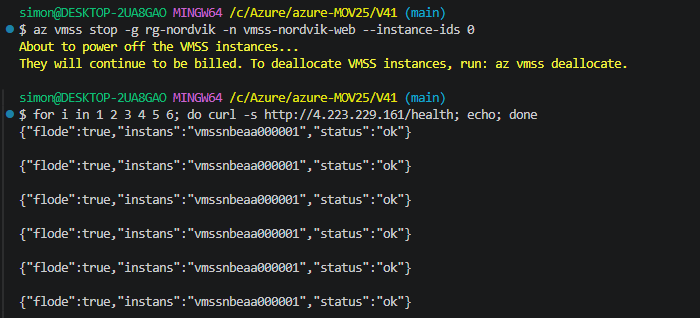

---

## 2. IAM

**Princip:** varje roll får **bara** det den behöver (least privilege). Behörigheter ges till **grupper**, inte till personer. När en förvaltare börjar eller slutar ändras bara medlemskapet i gruppen.

| Vem | Roll | Scope | Varför |
| :--- | :--- | :--- | :--- |
| Scale settets identitet (portalen) | Storage Blob Data Contributor | Bara containern `felanmalningar` | Portalen ska skriva felanmälningar, inget annat |
| `grp-nordvik-forvaltare` | Storage Blob Data Contributor | Containern `felanmalningar` | Hanterar felanmälningar och bilder |
| `grp-nordvik-forvaltare` | Reader | Resursgruppen | Ser att miljön mår bra, kan inte ändra |
| `grp-nordvik-ekonomi` | Reader + Cost Management Reader | Resursgruppen | Läsande insyn och kostnader, kan inte ändra något |
| `grp-nordvik-hyresgaster` | **Ingen Azure-roll** | – | Hyresgäster använder bara portalen. Portalen skriver åt dem. |
| Jag (admin) | Storage Blob Data Reader | Lagringskontot | För att verifiera blobbar i portalen |

I SharePoint ska behörigheterna följa samma roller: förvaltare i gruppen **Nordvik-medlemmar** (redigera) och ekonomi i **Nordvik-besökare** (läsa). I labben är jag ensam användare, så det är planerat men inte gjort.

**Hanterad identitet i stället för nycklar.** Scale settet får en system-tilldelad identitet (`--assign-identity`). Den får sin roll på **containern**, inte på hela kontot:

```bash
PRINCIPAL_ID=$(fraga az vmss show -g "$RG" -n "$VMSS" --query identity.principalId -o tsv)
roll "$PRINCIPAL_ID" ServicePrincipal "Storage Blob Data Contributor" "$CONTAINER_ID"
```

I `app.py` loggar appen in med `DefaultAzureCredential`. Den hittar identitetens token automatiskt:

```python
# DefaultAzureCredential hittar serverns hanterade identitet automatiskt.
# Det finns ingen nyckel eller losenord i koden.
_credential = DefaultAzureCredential()
_blob_service = BlobServiceClient(account_url=ACCOUNT_URL, credential=_credential)
```

Lagringskontot har dessutom `allowSharedKeyAccess: false`. Då **fungerar inga nycklar alls**, inte ens om någon skulle hitta en. Bara Entra-identiteter med en RBAC-roll kommer in.

Grupperna skapas i `build.sh` (Entra-grupper kan inte skapas med ARM):

```bash
FORVALTARE_ID=$(grupp grp-nordvik-forvaltare "Nordvik: hanterar felanmalningar")
EKONOMI_ID=$(grupp grp-nordvik-ekonomi "Nordvik: lasande insyn och kostnader")
grupp grp-nordvik-hyresgaster "Nordvik: hyresgaster, ingen direkt Azure-atkomst" > /dev/null

roll "$FORVALTARE_ID" Group "Storage Blob Data Contributor" "$CONTAINER_ID"
roll "$FORVALTARE_ID" Group "Reader" "$RG_ID"
roll "$EKONOMI_ID" Group "Reader" "$RG_ID"
roll "$EKONOMI_ID" Group "Cost Management Reader" "$RG_ID"
```

Funktionen `roll` försöker upp till 5 gånger. En ny identitet kan ta en stund innan den syns överallt i Entra ID.

**Verifiering:** bild 13 och 14 (avsnitt 4) visar att portalen kunde spara JSON och bild. Det fungerar bara om identiteten och rollen är rätt, eftersom det inte finns någon nyckel.

---

## 3. Nätverk och säkerhet (defense in depth)

**Defense in depth** betyder flera skyddslager. Om ett lager missar ska nästa stoppa angriparen.

| Lager | Vad jag gjorde |
| :--- | :--- |
| **Identitet** | Entra-grupper med RBAC. Hanterad identitet. Inga nycklar (`allowSharedKeyAccess: false`). |
| **Perimeter** | Bara lastbalanserarens publika IP nås från internet. Rate limit i nginx: 10 anmälningar per minut per IP. |
| **Nätverk** | NSG: bara port 80 från internet, SSH bara från min IP, allt annat nekas. Samma NSG på subnätet och på nätverkskorten. |
| **Compute** | Flask lyssnar bara på `127.0.0.1`. Appen kör som `www-data`, inte root. systemd startar om den om den kraschar. Hälsokontrollen tar bort trasiga instanser. |
| **Applikation** | Servern kontrollerar alla fält, filtyp och storlek. `html.escape` stoppar XSS. `secure_filename` för filnamn. Bara POST till `/submit`. Säkerhetsrubriker. nginx visar inte sin version. |
| **Data** | Ingen publik blob-åtkomst. Lagringsbrandvägg: `Deny` utom `snet-web`. TLS 1.2. Soft delete 7 dagar. ZRS. `overwrite=False`. |
| **Hemligheter** | Flödets URL ligger i `flow-url.txt`, som stoppas av `.gitignore`. Appen loggar bara feltypen, aldrig URL:en. |
| **Kostnad och styrning** | Budgetlarm på 2 500 kr. Taggar på allt. |

**NSG:n i ARM-templaten.** SSH-regeln läggs bara till om en admin-IP finns:

```json
"securityRules": "[if(empty(parameters('adminIp')), variables('webRules'), concat(variables('webRules'), variables('sshRule')))]"
```

```json
{
  "name": "allow-http-internet",
  "properties": {
    "priority": 100, "direction": "Inbound", "access": "Allow", "protocol": "Tcp",
    "sourceAddressPrefix": "Internet", "destinationPortRange": "80"
  }
}
```

**Lagringsbrandväggen** släpper bara in webbsubnätet (och min IP när jag bygger):

```json
"networkAcls": {
  "defaultAction": "Deny",
  "bypass": "AzureServices",
  "virtualNetworkRules": [ { "id": "[variables('subnetId')]", "action": "Allow" } ],
  "ipRules": "[if(empty(parameters('adminIp')), createArray(), variables('storageIpRules'))]"
}
```

**nginx** är det första lagret i själva servern:

```nginx
# Max 10 felanmalningar per minut fran samma IP-adress (skydd mot spam).
limit_req_zone $binary_remote_addr zone=felanmalan:10m rate=10r/m;

server {
    server_tokens off;              # visa inte nginx-versionen
    client_max_body_size 10m;       # samma grans som i app.py

    add_header X-Content-Type-Options nosniff always;
    add_header X-Frame-Options DENY always;
    add_header Referrer-Policy no-referrer always;

    location = /submit {
        limit_except POST { deny all; }
        limit_req zone=felanmalan burst=5 nodelay;
        limit_req_status 429;
        proxy_pass http://127.0.0.1:5000/submit;
    }
}
```

| Rad | Varför |
| :--- | :--- |
| `limit_req_zone ... rate=10r/m` | Stoppar att någon spammar formuläret, till exempel vid en vattenläcka med 300 anmälningar |
| `burst=5 nodelay` | En hyresgäst som klickar två gånger blockeras inte direkt |
| `limit_req_status 429` | Rätt felkod: "för många anrop" |
| `limit_except POST` | `/submit` tar bara emot formulär |
| `client_max_body_size 10m` | Bilder är 2–5 MB. Större anrop stoppas innan de når appen. |

### Verifiering

**Test 4: lagringen nås inte från internet.**

Först försöker jag lista containern **utan inloggning** från min dator:

```bash
curl -s "https://stnordvik02simfat01.blob.core.windows.net/felanmalningar?restype=container&comp=list"
```

Resultat: `PublicAccessNotPermitted`. Min IP släpps igenom brandväggen, men anonym åtkomst är avstängd (`allowBlobPublicAccess: false`). Ingen lista visas.

**Bild 20.** Anonymt anrop till lagringen nekas.

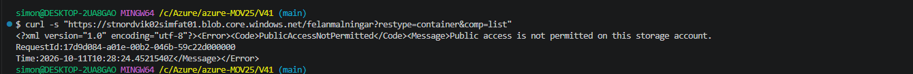

**Test 5: rate limit.** Jag skickar många tomma POST till `/submit`.

```bash
for i in $(seq 1 20); do curl -s -o /dev/null -w "%{http_code} " -X POST http://4.223.229.161/submit; done; echo
```

Förväntat: först `400` (formuläret är tomt, så appen sparar ingenting), sedan `429` när gränsen är nådd.

Mitt första försök med 12 anrop gav bara `400`. Det beror på att varje instans räknar för sig. Lastbalanseraren delade anropen på två servrar, så ingen av dem kom över sin gräns. Varje server släpper igenom 6 anrop direkt (1 + `burst=5`). Med 20 anrop syns `429`.

Resultat med 20 anrop: 12 × `400` och sedan 8 × `429`. Det stämmer med teorin: 6 anrop per server × 2 servrar = 12 anrop släpps igenom. Resten stoppas av nginx innan de når appen.

**Bild 21.** `429 Too Many Requests` efter för många anrop.

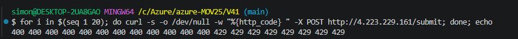

---

## 4. Storage

**Vad:** lagringskontot `stnordvik02simfat01` (StorageV2) med två containrar.

| Container | Innehåll | Nivå |
| :--- | :--- | :--- |
| `felanmalningar` | En mapp per felanmälan: `<id>/felanmalan.json` och `<id>/bild.jpg` | Hot |
| `dokument` | Kontrakt och protokoll | Hot, till **Cool efter 90 dagar** |

En mapp per felanmälan gör det lätt att hitta JSON och bild som hör ihop.

Säkerhetsinställningarna i ARM-templaten:

```json
"sku": { "name": "[parameters('storageSku')]" },
"kind": "StorageV2",
"properties": {
  "accessTier": "Hot",
  "minimumTlsVersion": "TLS1_2",
  "supportsHttpsTrafficOnly": true,
  "allowBlobPublicAccess": false,
  "allowSharedKeyAccess": false
}
```

| Inställning | Varför |
| :--- | :--- |
| `storageSku` = ZRS i drift, LRS i test | Drift tål att en zon går ner. Test är billigast. |
| `allowBlobPublicAccess: false` | Personuppgifter och bilder får aldrig bli publika |
| `allowSharedKeyAccess: false` | Inga nycklar. Bara Entra-identiteter med en roll. |
| `minimumTlsVersion` + `supportsHttpsTrafficOnly` | All trafik är krypterad |

**Soft delete** och **livscykelregel:**

```json
"deleteRetentionPolicy": { "enabled": true, "days": 7 },
"containerDeleteRetentionPolicy": { "enabled": true, "days": 7 }
```

```json
"filters": { "blobTypes": [ "blockBlob" ], "prefixMatch": [ "dokument/" ] },
"actions": {
  "baseBlob": {
    "tierToCool": { "daysAfterModificationGreaterThan": "[parameters('dokumentTillCoolDagar')]" }
  }
}
```

- Soft delete: en felanmälan som raderas av misstag går att få tillbaka i 7 dagar.
- Livscykelregeln: Nordviks 40 GB kontrakt läses sällan efter 3 månader. Cool kostar mindre att lagra.

**Så sparar appen** en felanmälan. Bilden först, sedan JSON:

```python
container = _blob_service.get_container_client(CONTAINER)
if bild is not None:
    ext = os.path.splitext(secure_filename(bild.filename))[1].lower()
    bild_namn = "{0}/bild{1}".format(arende_id, ext)
    container.upload_blob(name=bild_namn, data=bild.stream, overwrite=False,
                          content_settings=ContentSettings(content_type=bild.mimetype))
container.upload_blob(
    name="{0}/felanmalan.json".format(arende_id),
    data=json.dumps(felanmalan, ensure_ascii=False, indent=2).encode("utf-8"),
    overwrite=False,
    content_settings=ContentSettings(content_type="application/json; charset=utf-8"))
```

- `overwrite=False`: en felanmälan kan aldrig skrivas över.
- Går det inte att spara visar appen "Tekniskt fel" (503). Då anropas inte flödet. Ingen post i SharePoint utan sparad anmälan.

### Verifiering

**Bild 13.** `felanmalan.json` i containern. Samma ärende-ID som på tack-sidan. Fältet `instans` visar vilken server som tog emot anmälan.

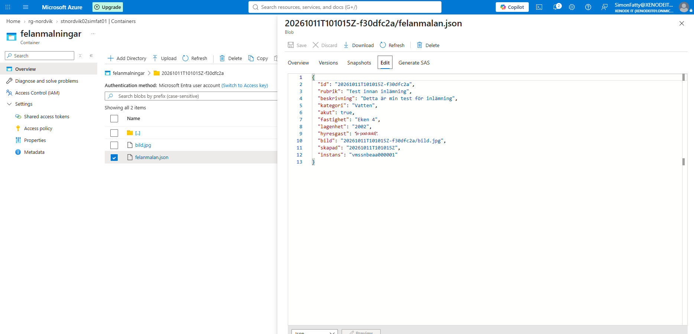

**Bild 14.** Bilden sparades i samma mapp.

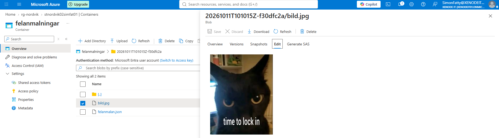

---

## 5. IaC med ARM

**Arbetsfördelning:** ARM-templaten bygger grunden. `build.sh` bygger resten med Azure CLI.

| Del | Var | Varför |
| :--- | :--- | :--- |
| NSG, VNet, subnät, service endpoint | ARM | Grunden. Deklarativ och likadan varje gång. |
| Lagring, containrar, soft delete, livscykelregel | ARM | Säkerhetsinställningarna ska alltid bli rätt |
| Scale set och lastbalanserare | CLI (`az vmss create`) | Samma kommando som i lektion 18B. Nästa steg: flytta in i ARM. |
| Hälsokontroll och regel för port 80 | CLI | Kräver lastbalanseraren som `az vmss create` skapar |
| RBAC och Entra-grupper | CLI | Entra-grupper kan inte skapas med ARM |
| Autoskalning | CLI | Kommandona från 18B, plus en nattprofil |

**En template, två miljöer.** Skillnaderna ligger i parameterfilerna:

| Parameter | `parametrar.prod.json` | `parametrar.test.json` |
| :--- | :--- | :--- |
| Resursgrupp | `rg-nordvik` | `rg-nordvik-test` |
| `storageName` | `stnordvik02simfat01` | `stnordvik02simfat02` |
| `storageSku` | `Standard_ZRS` | `Standard_LRS` |
| `vnetAddressPrefix` | `10.10.0.0/16` | `10.20.0.0/16` |
| `tags.miljo` | `prod` | `test` |

Adressrymderna krockar inte med varandra eller med Novatrix (`10.0.0.0/16`).

**Validera först, bygg sedan:**

```bash
az deployment group validate -g "$RG" \
  --template-file arm/azuredeploy.json --parameters "@$PARAMS" adminIp="$MY_IP" -o none
az deployment group create -g "$RG" -n nordvik-infra \
  --template-file arm/azuredeploy.json --parameters "@$PARAMS" adminIp="$MY_IP" -o none
```

Skriptet läser sedan templatens **outputs** (lagringsnamn, container-id, subnät-id). Då finns namnen bara på ett ställe: i parameterfilen.

**build.sh steg för steg:**

| Steg | Vad | Varför |
| :--- | :--- | :--- |
| 0 | Kollar konto, filer och `flow-url.txt` | Stannar tidigt med ett tydligt fel |
| 1 | Resursgrupp med taggar | En grupp per miljö, lätt att riva |
| 2 | `validate` och `create` av ARM-templaten | Nätverk, NSG och säker lagring |
| 3 | Fyller i lagringsnamn och flödets URL i en lokal kopia av cloud-init | Hemligheten hamnar aldrig i repot |
| 4 | Scale set med 2 instanser. Provar flera storlekar, först med zoner. | Tål att Azure saknar kapacitet för en storlek |
| 5 | Hälsokontroll `/health` kopplad till regeln för port 80 | En trasig instans tas ur drift |
| 6 | Identiteten får rollen på containern | Least privilege |
| 7 | Entra-grupper och roller | Nordviks tre roller |
| 8 | Autoskalning med nattprofil | Elastiskt, aldrig över kvoten |
| 9 | Väntar tills `/health` svarar genom lastbalanseraren | Verifiera, gissa inte |

Skriptet går att köra flera gånger. Det som redan finns hoppas över.

**Hemligheten hålls utanför repot.** `cloud-init.txt` i repot är en mall med platshållare. `build.sh` skapar en ifylld kopia som aldrig committas:

```bash
FLOW_URL_ESC=$(printf '%s' "$FLOW_URL" | sed -e 's/[\\&|]/\\&/g')
sed -e "s|stnordvikXXXX|$STORAGE|" \
    -e "s|FLOW_URL = \"\"|FLOW_URL = \"$FLOW_URL_ESC\"|" \
    cloud-init.txt > cloud-init.generated.txt
```

```text
# .gitignore
flow-url.txt
cloud-init.generated.txt
```

**Riva allt:**

```bash
bash destroy.sh          # river rg-nordvik
bash destroy.sh test     # river rg-nordvik-test
```

`destroy.sh` raderar hela resursgruppen och den lokala filen med URL:en. Entra-grupperna och budgetlarmet ligger kvar med flit. De kostar inget och återanvänds vid nästa bygge.

### Verifiering

**Bild 11.** Resursgruppen `rg-nordvik` efter bygget: lastbalanserare, NSG, publik IP, lagring, scale set och VNet. Alla har taggarna.

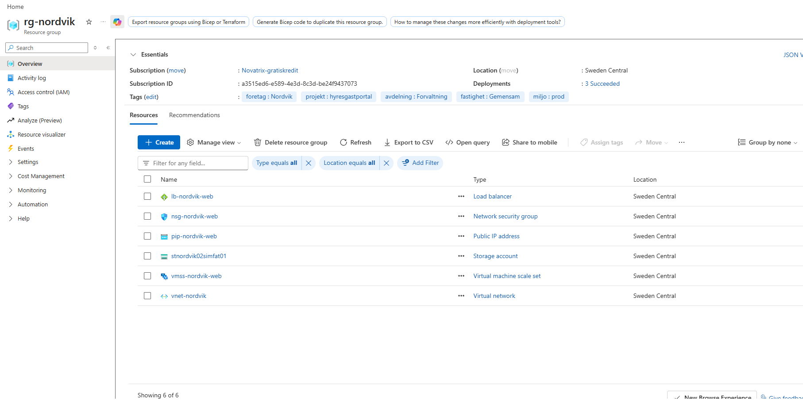

---

## 6. Automation och integration med Microsoft 365

### Val av verktyg

Läraren gav tre val: Power Automate, Logic Apps eller Azure Functions. Jag valde **Power Automate**.

| Alternativ | Fördel | Nackdel |
| :--- | :--- | :--- |
| **Power Automate** (mitt val) | Förvaltarna jobbar redan i M365. Färdiga kopplingar till SharePoint, Outlook och Teams. Jag byggde och testade samma mönster i V39. | Kan inte byggas med ARM. Beskrivs steg för steg i README:n i stället. |
| Logic Apps | Är en Azure-resurs. Kan byggas med ARM. Kan använda hanterad identitet. | M365-kopplingarna måste ändå godkännas för hand. Nytt för mig. |
| Azure Functions | Egen kod, full kontroll | Kräver app-registrering och Graph-behörigheter. Mest kod. |

**Motivering:** Power Automate gav lägst risk och fungerar direkt med Nordviks Microsoft 365. Logic Apps är nästa steg om flödet också ska byggas som kod.

### SharePoint-listorna

Webbplatsen heter **Nordvik**. Den har två listor.

**Fastigheter**: vem som är ansvarig förvaltare.

| Kolumn | Typ |
| :--- | :--- |
| Fastighet | Text, unik |
| ForvaltareNamn | Text |
| ForvaltareEpost | Text |

Rader: Björken 1, Eken 4, Linden 7. I testet är jag förvaltare för alla tre.

**Felanmälningar**: registret.

| Kolumn | Typ |
| :--- | :--- |
| Rubrik | Text |
| ArendeID | Text, indexerad |
| Beskrivning | Flera rader |
| Kategori | Val: Värme, Vatten, Lås, El, Ventilation, Vitvaror, Tvättstuga, Övrigt |
| Akut | Ja/Nej |
| Fastighet | Text, indexerad |
| Lagenhet | Text |
| Hyresgast | Text |
| Bild | Text (sökväg i lagringen) |
| Forvaltare | Text (e-post) |
| Status | Val: Ny, Pågår, Åtgärdad. Standard: Ny. |

**Varför en egen lista för fastigheter?** Nordvik växer med 5–8 fastigheter per år. En ny fastighet är bara en ny rad i listan. Ingen kod och inget flöde behöver ändras.

### Flödet "Nordvik Felanmalan till M365"

```text
manual                      När en HTTP-begäran tas emot (appen skickar JSON)
   ▼
Hamta forvaltare            SharePoint: Hämta objekt i Fastigheter (filter på fastigheten)
   ▼
Skapa felanmalan            SharePoint: Skapa objekt i Felanmälningar
   ▼
Om akut                     Villkor: akut = true
   ├── Sant:  Akut mejl till forvaltare   (Outlook, hög prioritet)
   └── Falskt: inget
   ▼
Notis till forvaltare       Teams: chattmeddelande till förvaltaren, med länk till raden
```

| Steg | Varför |
| :--- | :--- |
| HTTP-trigger | Startar direkt när appen har sparat. Ingen fördröjning. |
| Hämta förvaltare **före** allt annat | Notisen ska gå till **rätt** person, inte till en hel kanal |
| Skapa raden före notisen | Registret är det viktigaste. Notisen kan länka till raden. |
| Villkor för akut | Värme, vatten och lås får inte missas |

**JSON som appen skickar:**

```json
{
  "id": "20261011T101015Z-f30dfc2a",
  "rubrik": "...",
  "beskrivning": "...",
  "kategori": "Vatten",
  "akut": true,
  "fastighet": "Eken 4",
  "lagenhet": "...",
  "hyresgast": "...",
  "bild": "20261011T101015Z-f30dfc2a/bild.jpg",
  "skapad": "20261011T101015Z",
  "instans": "..."
}
```

**Viktiga uttryck i flödet:**

```text
Filter i Hamta forvaltare:   Title eq '@{triggerBody()?['fastighet']}'
Förvaltarens e-post:         @{first(body('Hamta_forvaltare')?['value'])?['ForvaltareEpost']}
Villkoret Om akut:           @triggerBody()?['akut']  är lika med  @true
Länk till raden:             @{body('Skapa_felanmalan')?['{Link}']}
```

- `first(...)` behövs eftersom "Hämta objekt" alltid ger en **lista**, även när den bara har en rad.
- `@triggerBody()?['akut']` utan `{}` behåller värdet som boolean. Med `@{...}` blir det text, och då blir jämförelsen fel.

**Appen anropar flödet** först när felanmälan är sparad. Anropet ligger i `try/except`:

```python
def _skicka_till_flode(felanmalan):
    # Om flodet ar nere finns felanmalan anda kvar i lagringen.
    if not FLOW_URL:
        return
    try:
        data = json.dumps(felanmalan, ensure_ascii=False).encode("utf-8")
        req = urllib.request.Request(FLOW_URL, data=data, method="POST",
              headers={"Content-Type": "application/json; charset=utf-8"})
        with urllib.request.urlopen(req, timeout=10) as svar:
            log.info("Flodet svarade %s for id %s", svar.status, felanmalan["id"])
    except Exception as e:
        # Logga bara felets typ. Hela felet kan innehalla flodets URL.
        log.error("Flodet kunde inte anropas for id %s: %s", felanmalan["id"], type(e).__name__)
```

**Säkerhet för flödet:** flödets URL innehåller en signatur (`sig=`). Den fungerar som ett lösenord. Den ligger bara i `flow-url.txt`, som stoppas av `.gitignore`. Den som får tag i URL:en kan skicka falska anmälningar. Därför hålls den hemlig (se också Nästa steg).

### Verifiering

Först testade jag flödet utan Azure, med `curl` och testfilerna i `test/`:

```bash
curl -i -X POST "$(tr -d '\r\n' < flow-url.txt)" -H "Content-Type: application/json; charset=utf-8" --data-binary @test/akut-varme.json
```

| Testfil | Kategori | akut | Förväntat | Resultat |
| :--- | :--- | :--- | :--- | :--- |
| `akut-varme.json` | Värme, Eken 4 | true | Rad, Teams-notis och AKUT-mejl | ✅ 202, rad, notis och mejl |
| `vanlig-el.json` | El, Björken 1 | false | Rad och Teams-notis, **inget** mejl | ✅ 202, rad och notis, inget mejl |

**Bild 1.** Flödet svarar `202 Accepted` på det akuta testet. URL:en är beskuren bort.

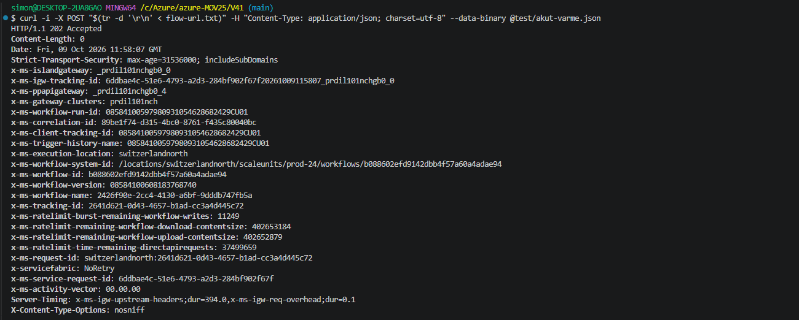

**Bild 2.** Raden i Felanmälningar: Akut är ikryssad, förvaltaren är ifylld, status är Ny.

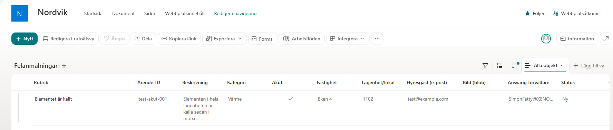

**Bild 3.** Teams-notisen till förvaltaren, med länk till raden.

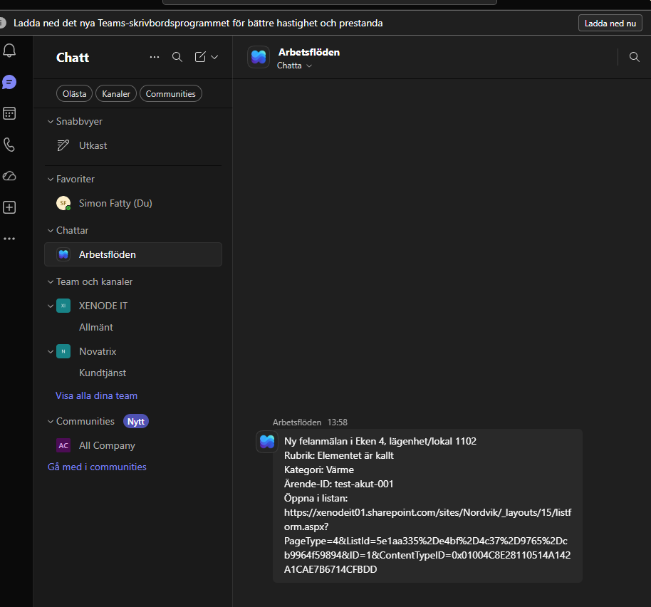

**Bild 4.** AKUT-mejlet med hög prioritet.

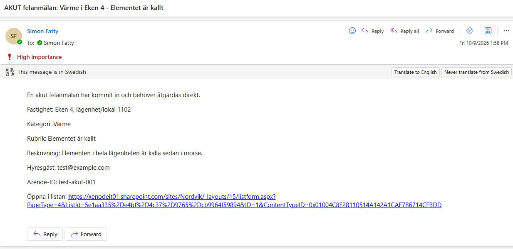

**Bild 7.** Det vanliga testet svarar också `202`.

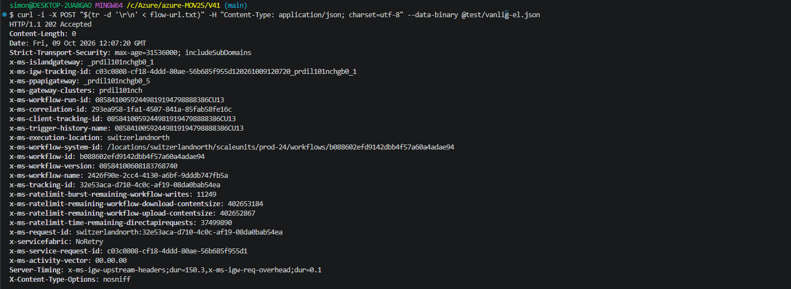

**Bild 5.** Två rader i listan: en akut och en vanlig.

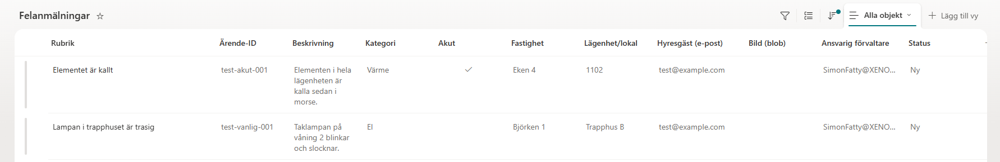

**Bild 6.** Två notiser i Teams. Bara den akuta gav mejl.

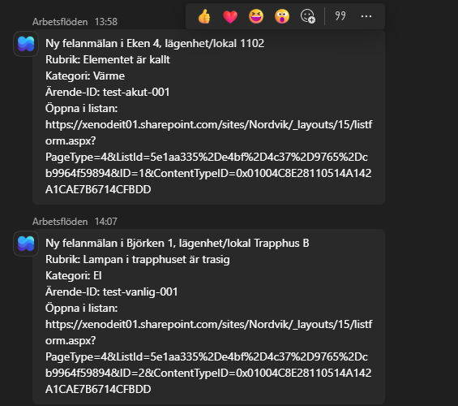

**Hela kedjan (test 1).** Sedan skickade jag en felanmälan med bild genom formuläret på riktigt (bild 12–14 ovan). Samma ärende-ID `20261011T101015Z-f30dfc2a` syns i alla delar.

**Bild 15.** Notisen för felanmälan från formuläret.

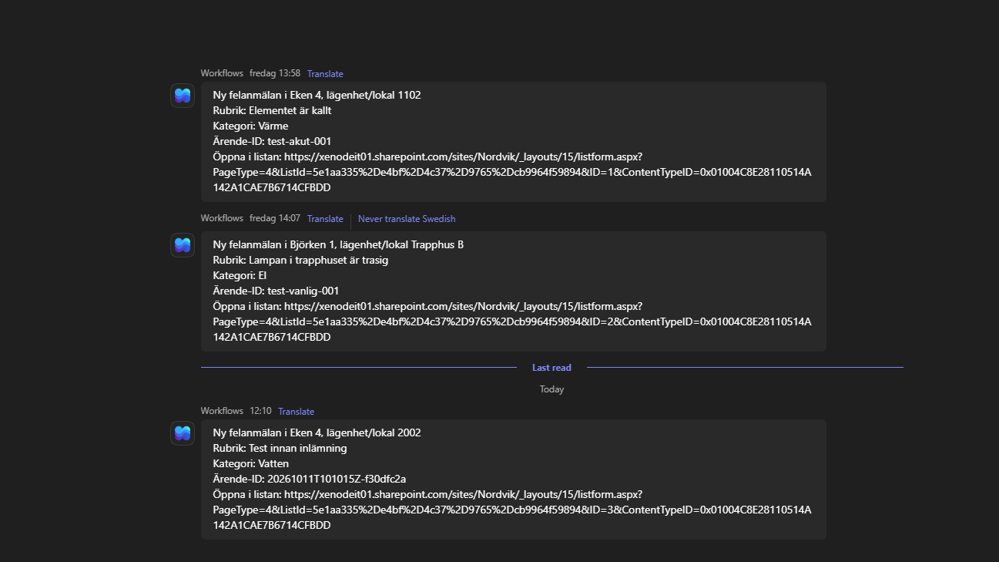

**Bild 16.** Raden för felanmälan från formuläret, nu med sökväg till bilden.

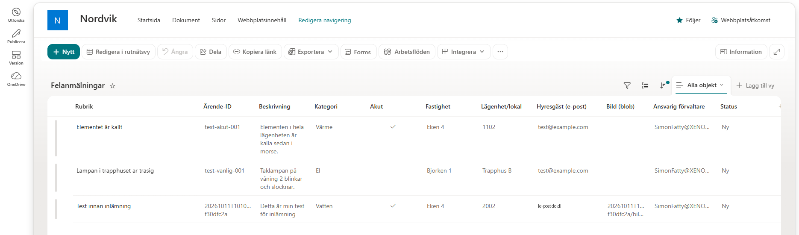

---

## 7. Dokumentation och återskapning

Den här README:n beskriver hur lösningen är planerad, byggd och testad. Så här återskapar någon annan hela lösningen från repot.

**Förutsättningar:** Azure-prenumeration, Azure CLI, Git Bash och ett Microsoft 365-konto med SharePoint, Teams, Outlook och Power Automate.

1. **Klona repot**

   ```bash
   git clone https://github.com/02simfat/azure-MOV25.git
   cd azure-MOV25/V41
   az login
   ```

2. **Microsoft 365**
   - Skapa webbplatsen och de två listorna enligt tabellerna i avsnitt 6.
   - Bygg flödet enligt avsnitt 6. Koppla SharePoint, Outlook och Teams.
   - Kopiera flödets HTTP-URL till filen `flow-url.txt`. **Committa den aldrig.**

3. **Bygg Azure-delen**

   ```bash
   bash build.sh          # drift: rg-nordvik
   bash build.sh test     # eller test: rg-nordvik-test
   ```

   Det tar ungefär 10–15 minuter. Skriptet skriver ut portalens adress på slutet.

4. **Testa:** öppna `http://<IP>`, skicka en felanmälan och kolla SharePoint och Teams.

5. **Riv när du är klar**

   ```bash
   bash destroy.sh
   ```

**Innan commit** kollar jag att ingen hemlighet följer med:

```bash
git status                  # flow-url.txt och cloud-init.generated.txt ska INTE synas
git grep --cached -n -E "sig=[A-Za-z0-9_%-]{20,}" -- V41   # en riktig signatur: ska inte ge någon träff
```

---

## Kostnad

Nordviks riktvärde är **2 500 kr per månad**. Budgeten `budget-nordvik` larmar vid 10 %, 50 % och 100 % faktisk kostnad och vid 100 % prognos.

Uppskattning per månad för driftmiljön i Sweden Central (listpris, betala per användning, räknat grovt med 1 USD ≈ 10 kr):

| Del | Antagande | Ca kr per månad |
| :--- | :--- | :--- |
| 2 × Standard_B2ats_v2 | Ca 0,0097 USD per timme. 2 instanser 18 h, 1 instans 6 h natt: ca 1 280 timmar. | 125 |
| OS-diskar | En disk per instans | 50–100 |
| Load Balancer Standard | Ca 0,025 USD per timme för upp till 5 regler | 180 |
| Publik IP (Standard) | Ca 0,005 USD per timme | 35 |
| Lagring | 10 GB bilder (Hot, ZRS) + 40 GB dokument (Cool) + anrop | 20 |
| **Summa Azure** | | **ca 400–500** |

Siffrorna är avrundade listpriser från oktober 2026. Inför ett riktigt beslut ska de kontrolleras i [Azure Pricing Calculator](https://azure.microsoft.com/pricing/calculator/).

**Slutsatser:**

- Lösningen ligger **långt under 2 500 kr**. Det finns utrymme för fler instanser vid toppar.
- Den största kostnaden är **lastbalanseraren**, inte servrarna. Den behövs ändå för tillgängligheten.
- Nattprofilen sparar bara ungefär 20 kr per månad, eftersom B-storleken är billig. Den viktiga effekten är att kostnaden **följer lasten** när Nordvik växer.
- **Power Automate:** triggern "När en HTTP-begäran tas emot" räknas som en premium-funktion. Den som äger flödet behöver en licens som täcker det. Det ska kontrolleras mot Nordviks licenser. Ett alternativ är Logic Apps, där man betalar per körning.
- **Taggarna** gör att ekonomi kan följa kostnaden per avdelning och fastighet i Cost Management.

---

## Avgränsningar

Det här gjorde jag medvetet inte, och varför:

| Avgränsning | Varför | I verkligheten |
| :--- | :--- | :--- |
| **Autoskalning max 2 instanser** | Gratiskrediten har en vCPU-kvot på 4. B2ats_v2 har 2 vCPU. `build.sh` räknar ut max från kvoten. | Nordviks prenumeration: max 4 eller mer |
| **Bara HTTP, inget HTTPS** | Kräver en domän och ett certifikat | Application Gateway med TLS och WAF framför scale settet |
| **Ingen inloggning för hyresgäster** | Formuläret har ett e-postfält. Hyresgästen får ett ärende-ID men kan inte se sina gamla anmälningar i portalen. | Entra External ID för inloggning, och en sida "Mina anmälningar" |
| **Rate limit per instans** | Varje nginx räknar för sig | En gemensam gräns i Application Gateway WAF eller Front Door |
| **Flödets URL är en hemlig nyckel** | "Vem som helst" med URL:en kan starta flödet | Logic App med hanterad identitet, eller en Function |
| **Scale set och lastbalanserare byggs med CLI, inte ARM** | Samma kommandon som i lektion 18B, mindre risk | Flytta in i ARM-templaten |

---

## Problem och felsökning

### Problem 1: `SkuNotAvailable`

```text
(SkuNotAvailable) ... Following SKUs have failed for Capacity Restrictions: Standard_B1s
... is currently not available in location 'SwedenCentral'.
```

- **Orsak:** Azure hade tillfälligt ingen kapacitet för B1s (och B1ms) i Sweden Central.
- **Lösning:** `build.sh` provar nu flera små storlekar, först med zoner och sedan utan. Standard_B2ats_v2 i zon 1 och 2 fungerade.
- **Lärdom:** ett robust skript har en plan B.

### Problem 2: `RulesUseSameBackendPortProtocolAndPool`

```text
(RulesUseSameBackendPortProtocolAndPool) Load balancing rules .../LBRule and .../rule-http
... use the same protocol Tcp and backend port 80
```

- **Orsak:** `az vmss create` hade själv skapat en regel för port 80 (`LBRule`). Den skapade också en extra NSG på nätverkskorten, som blockerade port 80.
- **Lösning:** `--nsg nsg-nordvik-web`, så att samma NSG används på subnät och nätverkskort. Skriptet återanvänder regeln för port 80 om den redan finns.
- **Lärdom:** kontrollera vad ett kommando faktiskt skapar.

### Mindre problem

| Fel | Orsak | Lösning |
| :--- | :--- | :--- |
| `400` från flödet vid första testet | Git Bash skickade inte å, ä och ö som UTF-8 | Testdata i UTF-8-filer, skickas med `--data-binary @fil.json` |
| `bash: [200~curl: command not found` | "Bracketed paste": terminalen tog med osynliga koder från inklistrad text | Skriv kommandot på en rad, eller kör `bind 'set enable-bracketed-paste off'` |
| `InvalidParameter` vid `az vmss stop` | Jag skrev ärende-ID:t i stället för instansens nummer | `--instance-ids 0`. Numret syns i servernamnet: `...000000` är 0. |

---

## Nästa steg (förbättringar)

1. **Hela scale settet i ARM:** scale set, lastbalanserare, hälsokontroll och rolltilldelningar i templaten.
2. **Azure Policy:** kräv taggen `fastighet` på alla resurser.
3. **Budget i ARM:** `Microsoft.Consumption/budgets` på resursgruppen.
4. **HTTPS och WAF:** Application Gateway framför scale settet.
5. **Inloggning för hyresgäster:** Entra External ID och en sida "Mina anmälningar".
6. **Logic App i stället för Power Automate:** flödet som kod och hanterad identitet i stället för en hemlig URL.
7. **Kö vid skurar:** appen lägger felanmälan på en Storage Queue, och en Function skickar vidare till M365. Då klarar systemet 300 anmälningar på en timme även om M365 är långsamt.
8. **Flödet i repot:** exportera flödet (Lösningar → Exportera) så att det också är versionshanterat.

---

## Filer

```text
V41/
├── README.md                   den här dokumentationen
├── arm/
│   ├── azuredeploy.json        nätverk, NSG och säker lagring (ARM)
│   ├── parametrar.prod.json    drift: ZRS, 10.10.0.0/16
│   └── parametrar.test.json    test:  LRS, 10.20.0.0/16
├── cloud-init.txt              formulär, app.py, nginx och systemd (mall utan hemligheter)
├── build.sh                    bygger allt
├── destroy.sh                  river allt
├── test/
│   ├── akut-varme.json         testdata: akut felanmälan
│   └── vanlig-el.json          testdata: vanlig felanmälan
├── bilder/                     arkitekturskiss och skärmbilder
└── .gitignore                  stoppar flow-url.txt och cloud-init.generated.txt
```
